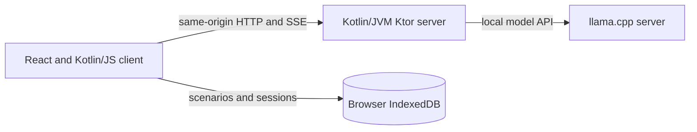

# AI Adventure

AI Adventure is a locally hosted, single-player interactive fiction app. A
Kotlin/JS browser client streams narrative turns from a Kotlin/JVM server, which
connects to a local [llama.cpp](https://github.com/ggml-org/llama.cpp) model.
Scenarios and saved sessions stay in the browser's IndexedDB; the server keeps
temporary coordination and model-slot state while sessions are active.

The project explores how to make long-running LLM adventures more reliable:

- Stream responses and action suggestions into the browser.
- Author scenarios in Markdown with YAML frontmatter for locations, flags,
  signals, and conditional runtime guidance.
- Track structured world state and apply deterministic scenario rules alongside
  optional model-based event checks.
- Resume browser-stored sessions and compact long histories into recaps when the
  model context approaches its configured budget.
- Reuse llama.cpp prompt-cache slots across prefill and turns, with tests for
  prompt-prefix and slot-retention contracts.

## Architecture



The browser owns scenario and session data. The application server coordinates
requests and model work, while llama.cpp owns model execution and prompt-cache
slots. The default server binding is loopback-only.

## Project status

This is a local-first project that requires a separately installed model server
and model. It is intended to demonstrate application architecture, streaming,
scenario parsing, browser persistence, and tests around LLM lifecycle behavior.
Model quality and performance depend on the model, llama.cpp build, hardware,
and configuration; this repository does not claim a universal benchmark.

## AI-assisted development

**This project was developed in large part with coding AI.**

## Getting started

You need JDK 21 or newer, Bash, a desktop browser, a local llama.cpp `llama-server` and a compatible GGUF model. Configure and start the application:

```bash
cp .env.example .env
# Set PRIMARY_MODEL_PATH in .env
./server.sh
```

Open [http://127.0.0.1:8080/](http://127.0.0.1:8080/). See the [running guide](docs/running.md) for configuration, model wrappers, diagnostics and context management.

## Load an example

The [scenario authoring guide](docs/authoring-scenarios.md) describes supported
fields and variants, including locations, flags, signals and runtime fragments.
Import an example in the browser:

- [`examples/test-game.md`](examples/test-game.md): a lighthouse adventure with
  conditional runtime fragments and signal references.
- [`examples/the-facility.md`](examples/the-facility.md): a facility exploration
  adventure with locations, flags, signals and runtime fragments.
- [`examples/signal-test-game.md`](examples/signal-test-game.md): a signal test
  with three flags and four independent event checks.

## Documentation

- [Running and configuration](docs/running.md)
- [Verification and troubleshooting](docs/verification.md)
- [Scenario authoring](docs/authoring-scenarios.md) and [scenario rules](docs/scenario-rules.md)
- [Prompt cache verification](docs/llama-cpp-prefill-verification.md)
- [Gameplay architecture roadmap](docs/gameplay-architecture-roadmap.md)

Run `./gradlew check` to compile and test both modules. See the verification guide for browser test requirements.
