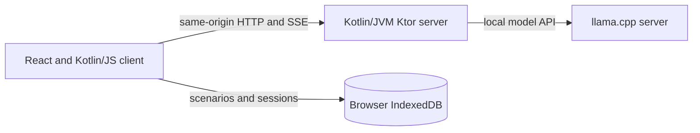

# AI Adventure

AI Adventure is a locally hosted, single-player interactive fiction app. A
Kotlin/JS browser client streams narrative turns from a Kotlin/JVM server, which
connects to a local [llama.cpp](https://github.com/ggml-org/llama.cpp) model.
Scenarios and saved sessions stay in the browser's IndexedDB; the server keeps
temporary coordination and model-slot state while sessions are active.

The project explores how to make long-running LLM adventures more reliable:

- Stream responses and action suggestions into the browser.
- Author scenarios in Markdown with YAML frontmatter for locations, flags,
  signals, and conditional runtime guidance.
- Track structured world state and apply deterministic scenario rules alongside
  optional model-based event checks.
- Resume browser-stored sessions and compact long histories into recaps when the
  model context approaches its configured budget.
- Reuse llama.cpp prompt-cache slots across prefill and turns, with tests for
  prompt-prefix and slot-retention contracts.

## Architecture



The browser owns scenario and session data. The application server coordinates
requests and model work, while llama.cpp owns model execution and prompt-cache
slots. The default server binding is loopback-only.

## Project status

This is a local-first project that requires a separately installed model server
and model. It is intended to demonstrate application architecture, streaming,
scenario parsing, browser persistence, and tests around LLM lifecycle behavior.
Model quality and performance depend on the model, llama.cpp build, hardware,
and configuration; this repository does not claim a universal benchmark.

## Prerequisites

- JDK 21 or newer, Bash, and a supported desktop browser
- A local `llama-server` from [llama.cpp](https://github.com/ggml-org/llama.cpp)
- A compatible GGUF model and enough memory to run it; requirements depend on the model

The exact llama.cpp version, model and hardware combination has not yet been
documented as a reproducible reference setup. The required server endpoints are
listed under [Long adventures](#long-adventures).

## Start

Create a local configuration, set `PRIMARY_MODEL_PATH` and, if necessary, the
remaining values, then start the local process:

```bash
cp .env.example .env
# Edit .env to set PRIMARY_MODEL_PATH and, if needed, the remaining values.
./server.sh
```

`server.sh` starts one local llama.cpp server. It owns the cache slots and also
performs the structured World-State update after each visible turn. On `Ctrl-C`
or `TERM`, it terminates the llama.cpp and application children.

To use an existing model wrapper script, set this in `.env`:

```dotenv
PRIMARY_MODEL_SCRIPT=/opt/models/primary-model.sh
```

A nonempty `PRIMARY_MODEL_SCRIPT` overrides `PRIMARY_MODEL_PATH` and
`PRIMARY_THREADS`; those values can be omitted in wrapper mode. Empty script
values retain the GGUF configuration. Script files must be readable and
executable; relative paths are resolved from the project directory. Quote paths
containing spaces.

The launcher calls the script with `llama-server` as its first argument, then
`-rea off --port <configured port> --slot-save-path
<temporary directory>`. The wrapper supplies model and performance settings and
must forward the remaining arguments **after** its own options, for example:

```bash
#!/usr/bin/env bash
exec "$1" --model /opt/models/model.gguf -t 1 "${@:2}"
```

Keep the server in the foreground; do not detach it with `setsid` or daemonize it.
The launcher terminates wrapper children when stopped or when any component exits.

Open [http://127.0.0.1:8080/](http://127.0.0.1:8080/) in the browser.

The server listens only on `127.0.0.1:8080` by default.
Set `PORT` in `.env` to use another port (for example, `PORT=8088`), then open
that port in the browser. API requests use the same origin as the page.
Set `ADVENTURE_EXPOSE_LAN=true` only when you intentionally need the API reachable on
your LAN. Do not use that setting on an untrusted network.

### Debug panel

The session's debug panel keeps a separate, initially expanded card for each
emitted text, flag assignment (including unchanged values), and detected signal.
Cards show the source and link back to the associated turn. Click a title to
collapse it; use the information icon for technical details. Diagnostics stay in
this browser with the session, including results that finish in the background.
“Clear debug log” removes the session's diagnostics.

### TRACE diagnostics

`LOG_LEVEL=TRACE` is an opt-in local diagnostic mode. It deliberately records
scenario, action, prompt and complete LLM-response content, including the raw
structured World-State response, so cache and model behavior can be inspected.
Do not enable it when those local logs may be exposed.

### Connect to llama.cpp

Import or open a scenario, then start a new session or resume a saved one. The
server owns the localhost llama.cpp connection and its single model; scenarios
and sessions remain in this browser profile.

While typing an action, the browser silently sends a debounced `POST /api/prefill`
for the current session. The server responds with `202 Accepted`; this does not add a
transcript entry or block sending. Sending the action uses `POST /api/turn` with the
same `sessionId`, allowing llama.cpp to reuse that session's cache. `--parallel 1`
is unnecessary: each active session reserves its own slot, and a full server returns
a safe busy error rather than using another session's cache. The launcher configures
llama.cpp with a writable temporary slot directory so it can clear released slots.

### Long adventures

The game automatically creates narrative recaps as the Primary model context fills.
It keeps recent turns verbatim and switches to a new prompt epoch after three further
completed turns, or earlier when space runs low. Recaps use the session's reserved
Primary slot; a maintenance turn can take longer to finish while you continue typing.
The full transcript and active/pending recaps remain in browser IndexedDB and survive
reloading a saved game. Recaps do not replace the authoritative world state.

Budgets use the actual chat template and tokenizer plus the retained slot's `n_ctx`.
The Primary server must expose `/apply-template`, `/tokenize`, `/slots` and `/completion`.
If the scenario, action and required response reserve cannot fit safely, the game
reports a context-limit error. An already oversized old save can require a larger
llama.cpp context; the application does not silently discard its history.

The early compaction threshold is configurable in `.env` with
`CONTEXT_COMPACTION_THRESHOLD`, as a percentage of the active slot's `n_ctx`.
It accepts integer values from `1` to `99` and defaults to `65`. The slot's actual
`n_ctx` remains the hard limit.

The browser still sends the full archive so the stateless server can verify checkpoint
coverage. Request safety limits are 100,000 history entries and 20 million history
characters, independently of the much smaller effective model prompt.

## Load an example

The [scenario authoring guide](docs/authoring-scenarios.md) describes supported
fields and variants, including locations, flags, signals and runtime fragments.
Import an example in the browser:

- [`examples/test-game.md`](examples/test-game.md): a lighthouse adventure with
  conditional runtime fragments and signal references.
- [`examples/the-facility.md`](examples/the-facility.md): a facility exploration
  adventure with locations, flags, signals and runtime fragments.
- [`examples/signal-test-game.md`](examples/signal-test-game.md): a signal test
  with three flags and four independent event checks.

## Verify

```bash
./gradlew check
```

The command compiles both modules and runs their test suites.
Browser tests use headless Chromium; install Chromium or Chrome and set
`CHROME_BIN` if it is not found automatically. The build downloads its Gradle,
Kotlin, Node.js and npm dependencies on first use.

Run `bash scripts/test-server-launcher.sh` for isolated launcher regression tests
(requires Python 3; does not start actual models or modify your `.env`).

The repository includes a Woodpecker CI configuration for Codeberg. It requires
the repository to be enabled in a Woodpecker instance; configuration alone does
not establish that a hosted run has occurred.

### Troubleshooting

- If `./server.sh` cannot find the model, check `PRIMARY_MODEL_PATH` and file
  permissions in `.env`; if using a wrapper, check that it is executable.
- If the page cannot connect, check the application health endpoint below and
  confirm that the configured port matches the browser URL. A successful health
  response does not establish that the model server is available.
- If a saved game exceeds the model context, use a larger configured llama.cpp
  context. The application reports a limit rather than silently dropping history.

### Local smoke test

Create a scenario file named `harbor.md`:

```markdown
# Fog Harbor
You are investigating a missing lighthouse keeper.
```

With the application server running, check that its HTTP endpoint is reachable:

```bash
curl -fsS http://localhost:8080/api/health
```

The command returns `{"status":"ok"}`. This health endpoint confirms that the
application server responds; it does not verify llama.cpp connectivity.

A successful `POST /api/turn` is an SSE response: it sends one or more `token`
frames followed by a terminal `done` frame:

```bash
curl -N -X POST http://localhost:8080/api/turn \
  -H 'Content-Type: application/json' \
  --data '{"sessionId":"manual-check","scenarioMarkdown":"# Fog Harbor","history":[],"playerAction":"look"}'
```

With `./server.sh` running, open http://127.0.0.1:8080/, import
`harbor.md`, open **Fog Harbor**, and start a session. Send a short action,
reload the page, reopen the scenario, resume the saved session, then send a
second short action without changing the scenario.
Scenarios and sessions are stored in this browser's IndexedDB, so they persist
across a reload of the same browser profile; the server has no session storage.

For a request-level check, use the browser's Network panel: both `POST
/api/turn` requests contain the same `scenarioMarkdown`; the second request's
`history` contains the first completed turn. The server constructs the prompt
from its instructions, scenario, history and the new player action. A location
catalog, when present, is included in the scenario context.

### Cache metrics

The UI displays optional duration, prompt-token, and cache-token metrics. On
llama.cpp versions that report them, `timings.cache_n` is the reused prompt-token
count and `timings.prompt_n` is the newly evaluated prompt-token count. The
top-level `tokens_cached` and `tokens_evaluated` fields may instead describe
the final cache occupancy and total prompt length; their meaning is version
dependent. If the timing counts are unavailable, cache reuse is unknown. Do not
infer a cache hit from timing or from a second turn alone. See
[`docs/llama-cpp-prefill-verification.md`](docs/llama-cpp-prefill-verification.md)
for the privacy-safe live verification checklist. That checklist uses a
disposable frontmatter template and covers the first turn (no fragment), a
later hidden fragment, reload/resume, and a following cache-reusing turn. Its
evidence record contains only request IDs, the retained slot identity, and
the reported reuse/evaluation counts.

### Signal event checks

Scenario frontmatter can declare signals independently of retrieval guidance:

```yaml
flags: {visited: false}
signals:
  enters-tower:
    event-check: The player actually entered the tower during this exchange.
    condition: {visited: false}
    triggers:
      - set-flag: {visited: true}
      - emit-text: The keeper now trusts the player; reveal the hidden stair on the next round.
```

A nonblank `event-check` describes an actual event, rather than
an intention or a relevant fragment. `condition` optionally requires declared
flag values and/or a location; all entries must match (AND). Explicit event checks use only this signal condition, regardless
of conditions on fragments referencing the signal. Checks run after the completed
exchange, using flags from the start of the turn; successful assignments apply in
declaration order without triggering further checks in that same turn.

`emit-text` accepts nonblank fixed text, and text-only signals work without a
`flags` declaration. Successful checks add their texts to the next round's hidden
runtime context, in signal and trigger declaration order, followed by any selected
runtime fragment. Blank lines separate these paragraphs in one context entry.
This entry is saved with the session and survives reload without being added twice.
Text-emitting signals are checked even when their flag assignments would not change
anything; use a condition and flag assignment when an event should fire only once.

Signals with absent, null, empty, or blank `event-check` never receive automatic model checks: signal names
and fragment paths are not fallback predicates. A selected runtime fragment fires
its referenced signals when the fragment and signal conditions match the turn-start
flags and current world location. Direct rules and location entry triggers also fire
signals without model checks. A deterministic trigger suppresses an additional event
check for that signal in the same turn. The old signal `description` field is no
longer accepted; location descriptions keep their `description` field.

### Conditional runtime guidance

Runtime-fragment conditions accept multiple flags with AND semantics. A condition
list applies every matching branch independently; an optional final `else` applies
only when none of its sibling branches match. `then` and `else` contain nonempty
mappings and can nest conditions, direct actions, and named fragments:

```yaml
flags: {visited: false, clue-known: false, hint-sent: false}
signals:
  unlock-hint:
    triggers:
      - set-flag: {hint-sent: true}
      - emit-text: Connect the clue to the keeper's hidden stair.
runtime-fragments:
  condition:
    - visited: true
      clue-known: true
      hint-sent: false
      then:
        emit-text: The player can now combine the tower and clue evidence.
        signal: unlock-hint
    - clue-known: true
      then:
        emit-text: Keep the discovered clue in the next round's context.
    - else:
        emit-text: Keep the missing clue unresolved.
  "The player examines the keeper's stair": Reveal the weathered handrail.
```

A `condition` directly under `runtime-fragments` evaluates before embedding
retrieval. Its direct `emit-text` and `signal` actions need no match text or model
check. A direct signal runs its declared actions without an event classifier, provided
its own signal condition also matches the original flags. An undescribed signal
referenced exclusively by direct rules has no independent event check.
Rules and retrieval eligibility use the original flag snapshot, so assignments
do not activate other branches or retrieval candidates in that evaluation. Both matching branches above apply when the first
branch's prerequisites hold. The first branch becomes ineligible once `hint-sent`
is true; the second repeats while `clue-known` remains true.

Named children remain candidates for semantic retrieval and relevance checks.
They inherit rule conditions; direct root text and signal actions are consumed
there and are not inherited by these children. Text and signal inheritance within
named fragment groups remains supported. Direct rule text and
selected fragments supply hidden context for following responses: direct rule
texts first, triggered signal texts next, and the selected fragment last. The
selected fragment remains effective even if its own actions change flags. Declare `flags`
or `signals` to enable metadata names, including at the runtime-fragments root;
without either declaration these keys keep their legacy meaning as fragment names.
See [the authoring guide](docs/authoring-scenarios.md)
for nesting, validation, signal behavior, and a complete scenario.
