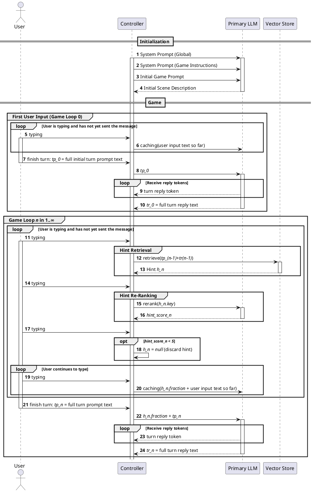

# Turn timing

This conceptual sketch explores how work can overlap with the player's reading and typing to reduce the time to first token (TTFT) after a turn is submitted. The table and sequence diagram describe the original design ideas, including vector-store hint retrieval and reranking; they are not a specification of the current implementation or measured timings.

## Timing overview

Time progresses down the table. The typing phase is a potential window for background work, but its duration is unknown. Work remaining after submission directly affects TTFT.

| Phase | User | Primary LLM | Secondary LLM | Other | Comment |
| --- | --- | --- | --- | --- | --- |
| … | | | | | |
| LLM text generation | Read streamed LLM output | Generate answer to previous user response | | | Generation must be at least as fast as the user's reading speed. |
| User typing text | Typing | | | Get hint from vector store | This is the “green area” for work without perceived performance impact, although its duration is unknown. |
| User typing text | Typing | Check whether hint is applicable | | | |
| User typing text | Typing | Cache hint text, if applicable | | | |
| User typing text | Typing | Incrementally cache partial user text | | | |
| User sending text | | Cache remaining user text | | | Everything in this phase is critical for TTFT. |
| LLM text generation | Read streamed LLM output | Generate answer to previous user response | | | Generation must be at least as fast as the user's reading speed. |
| … | | | | | |

## Sequence diagram

The diagram sketches initialization, the first turn, and subsequent turns with hint retrieval, reranking, incremental caching, and streamed responses.

